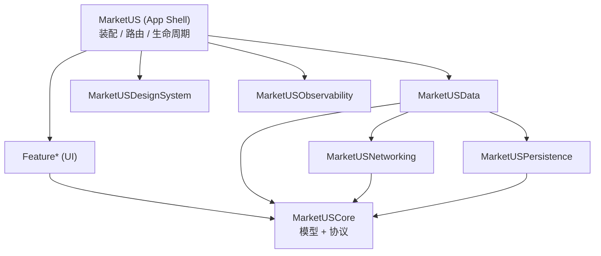
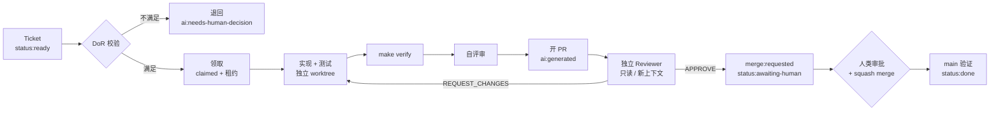

# MarketUS iOS

> 美股行情与自选股 iOS 客户端，配套一套 **AI Agent 自主接单 → 实现 → 评审 → 请求人工合并** 的工程工作流。

**核心理念：人类只做决策、设计与合并；实现与评审交给 Agent，但每一次变更都可追溯、可回滚、无法绕过门禁。**

---

## 1. 当前状态

| 项 | 状态 |
| --- | --- |
| 阶段 | **Phase 2 · 垂直切片完成**（PR #4 已合并；Phase 3 待启动） |
| 架构 | ✅ 已规划（Proposed，待确认；[`docs/architecture.md`](docs/architecture.md)） |
| Agent 契约 | ✅ [`AGENTS.md`](AGENTS.md) |
| 工作流规范 | ✅ [`docs/agent-workflow.md`](docs/agent-workflow.md) |
| Ticket 协议 | ✅ [`docs/ticket-protocol.md`](docs/ticket-protocol.md) |
| 代码 / Xcode 工程 | ✅ `project.yml` + `Package.swift` + 最小 App（`xcodegen generate` 已通过） |
| 构建 / 测试 | ✅ 已验证：Xcode 26.6 + iOS 26.5 模拟器，`make verify` 全绿 |
| CI | ⚠️ 2026-11-04 起 GitHub hosted-runner 获取失败（job 零步骤后取消）；历史 commit `cca95bf` 曾成功 |
| 分支保护 | ⬜ 建仓后按 [`docs/infrastructure.md`](docs/infrastructure.md) 配置 |
| 数据源 | ✅ Mock 优先（[`docs/data-sources.md`](docs/data-sources.md)） |
| 数据链路 | ✅ 默认 Mock；设置 `MARKET_BASE_URL` 切换 HTTP（缓存回退 + stale 标记） |
| 依赖基线 | ✅ 运行时零第三方依赖（[`docs/dependencies.md`](docs/dependencies.md)） |
| 仓库形态 | ✅ GitHub Public（[`docs/infrastructure.md`](docs/infrastructure.md)） |

> ⚠️ **构建尚未验证**：当前机器只安装了 Command Line Tools（`xcodebuild` 报错、无模拟器）。
> 安装 Xcode 并执行 `sudo xcode-select -s /Applications/Xcode.app` 后，运行 `make verify` 才算 Phase 1 完成。
> 在此之前，任何 PR 必须标注「未验证构建」，Agent 不得声称测试已通过。

---

## 2. 技术栈

| 领域 | 选择 | 理由 |
| --- | --- | --- |
| 语言 | Swift 6（严格并发） | 编译期消灭数据竞争，Agent 更难写出并发 bug |
| UI | SwiftUI + `ObservableObject` | iOS 16 无 `@Observable`；状态可单测 |
| 最低系统 | **iOS 16.0** | 覆盖更多存量设备；代价见 ADR-0001 |
| 工程生成 | **XcodeGen**（`.xcodeproj` 不入库） | 多人/多 Agent 并行时零工程文件冲突 |
| 模块化 | 单个本地 SPM Package + 多 target | 依赖边界由编译器强制，结构比多 Package 轻 |
| 网络 | 原生 `URLSession` + `async/await` | 零第三方依赖，可控 |
| 实时行情 | `URLSessionWebSocketTask` | 原生、可测（协议注入） |
| 存储 | `Codable` 原子文件存储 + Keychain | iOS 16 无 SwiftData；协议隔离，易测 |
| 测试 | XCTest / XCUITest（快照库待评估） | Swift Testing 需 iOS 17；核心逻辑可脱离模拟器 |
| 数据源 | App 内 Mock + 可选 Docker Mock Server | 无密钥、可离线、结果确定；真实源仅可选 |
| 依赖 | 运行时 **0** 个第三方库 | 供应链风险最低，见 [`docs/dependencies.md`](docs/dependencies.md) |
| CI | GitHub Actions（公开仓库标准 runner 免费） | 与 Issue/PR/分支保护原生集成 |
| 流程控制 | GitHub Issues 标签 + `gh` CLI | Agent 可直接操作，无需额外系统 |
| 仓库 | **GitHub Public** + MIT | 免费 CI、可公开审计；安全模型见基建文档 |

详细取舍见 [`ADR-0001`](docs/adr/0001-ios-tech-stack.md)。

---

## 3. 仓库文件架构

图例：**✅ 已存在（Phase 0）** · **🧩 Phase 1 创建** · **🔮 Phase 2+ 创建**

```
MarketUS-iOS/
│
├── README.md                          ✅ 本文件：项目总览 + 文件架构（唯一入口）
├── AGENTS.md                          ✅ Agent 最高行为契约：红线、工作循环、DoR/DoD
├── .gitignore                         ✅ 排除构建产物、密钥、worktree、Agent 运行记录
├── LICENSE                            ✅ MIT 许可（公开仓库）
├── SECURITY.md                        ✅ 漏洞披露与安全研究安全港
│
├── .github/                           ✅ 协作与流程配置（受保护路径：仅人类可改）
│   ├── CODEOWNERS                     ✅ 路径 → 人类 owner 映射；决定谁能审批什么
│   ├── PULL_REQUEST_TEMPLATE.md       ✅ PR 模板：验收对照 / 证据 / 风险 / 回滚
│   ├── labels.yml                     ✅ 标签即状态机（type/status/risk/priority/ai/merge/size）
│   ├── ISSUE_TEMPLATE/
│   │   ├── feature.yml                ✅ 功能需求表单（含 DoR 勾选项）
│   │   ├── bug.yml                    ✅ 缺陷表单（强制复现步骤 + 回归测试要求）
│   │   ├── chore.yml                  ✅ 工程任务表单（强制「不变的行为」）
│   │   └── config.yml                 ✅ 关闭空白 issue，引导到 Discussion / 安全通道
│   └── workflows/                     ✅ CI 流水线（规格见 docs/ci-cd.md）
│       ├── ci.yml                     ✅ lint / package tests / build / UI test / coverage
│       ├── agent-dispatch.yml         🧩 Phase 3：扫描 status:ready 并派发
│       └── nightly.yml                🧩 Phase 4：全量 UI + 性能基准
│
├── .agent/                            ✅ Agent 运行时契约（受保护路径）
│   ├── config.yml                     ✅ 并行数、租约、限额、门禁、受保护路径、通知
│   └── prompts/
│       ├── implementer.md             ✅ 实现 Agent 的职责、流程、输出格式、红线
│       └── reviewer.md                ✅ 评审 Agent 的只读约束、评分顺序、verdict 格式
│
├── docs/                              ✅ 工程规范文档（人类 owner 审批；adr/ 为受保护路径）
│   ├── README.md                      ✅ 文档索引：按角色给出阅读路径
│   ├── architecture.md                ✅ 分层、模块清单、并发模型、网络/存储/行情设计
│   ├── agent-workflow.md              ✅ 状态机、端到端时序、阶段门禁、并发与失败矩阵
│   ├── ticket-protocol.md             ✅ 字段规范、DoR、标签体系、领取协议、正反示例
│   ├── git-conventions.md             ✅ 分支/提交/PR/worktree/冲突/回滚
│   ├── code-review.md                 ✅ 双层评审、评分维度、P0–P3、iOS 专项清单
│   ├── merge-policy.md                ✅ 合并前置条件、风险分级、受保护路径、hotfix
│   ├── testing-strategy.md            ✅ 测试金字塔、覆盖率政策、flaky、Agent 测试职责
│   ├── ci-cd.md                       ✅ 流水线阶段、必需检查、权限、分支保护清单
│   ├── security-and-compliance.md     ✅ 威胁模型、注入防护、密钥、隐私、行情合规
│   ├── data-sources.md                ✅ Mock 行情方案、WS 契约、真实源对比
│   ├── dependencies.md                ✅ 依赖白名单、许可证、准入与升级
│   ├── infrastructure.md              ✅ 公开仓库设置、分支规则、Actions 权限、成本
│   ├── implementation-plan.md         ✅ Phase 0→4 落地任务、脚手架模板、风险登记
│   ├── glossary.md                    ✅ 术语 / 级别 / 标签统一口径
│   ├── adr/                           ✅ 架构决策记录
│   │   ├── README.md                  ✅ ADR 何时写、如何编号、状态流转
│   │   ├── template.md                ✅ ADR 模板
│   │   ├── 0001-ios-tech-stack.md     ✅ 技术栈与模块化选型
│   │   ├── 0002-agent-model.md        ✅ 为什么 Agent 有写权但无合并权
│   │   ├── 0003-market-data.md        ✅ Mock 优先、真实源可选
│   │   └── 0004-dependencies.md       ✅ 运行时零第三方依赖
│   └── runbooks/                      ✅ 故障处置手册
│       ├── agent-stuck.md             ✅ 卡住/升级/租约回收/worktree 清理
│       └── ci-failure.md              ✅ CI 失败分类、诊断命令、重跑规则、禁止清单
│
├── project.yml                        ✅ XcodeGen 工程定义（唯一事实来源，受保护路径）
├── Makefile                           ✅ 统一命令接口：bootstrap/lint/format/build/test/verify
├── .xcode-version                     ✅ 锁定 Xcode 版本
├── .swiftlint.yml                     ✅ 静态分析规则
├── .swiftformat                       ✅ 格式化规则
├── .gitleaks.toml                     ✅ 密钥扫描规则（allowlist 变更需人类审批）
├── Brewfile                           ✅ 工具链锁定（XcodeGen / SwiftLint / SwiftFormat / gitleaks）
│
├── App/                               ✅ 应用壳（组合根，不含业务实现）
│   ├── Sources/
│   │   ├── MarketUSApp.swift          ✅ @main 入口
│   │   ├── AppEnvironment.swift       ✅ 依赖装配（真实/预览/测试三套）
│   │   ├── RootView.swift             ✅ 根导航
│   │   ├── AppRouter.swift            🧩 类型化路由 + 深链解析
│   │   └── Resources/
│   │       ├── Assets.xcassets/       🧩 颜色/图标（语义色 Token）
│   │       ├── Localizable.xcstrings  🧩 字符串目录（禁止硬编码文案）
│   │       └── PrivacyInfo.xcprivacy  🧩 隐私清单（受保护路径）
│   └── Supporting/
│       ├── Info.plist                 ✅ 受保护路径
│       └── MarketUS.entitlements      ✅ 受保护路径
│
├── Packages/                          ✅ 业务代码（单 Package、多 target）
│   └── MarketUSKit/
│       ├── Package.swift              ✅ 依赖边界由 target 依赖强制（受保护路径）
│       ├── Sources/
│       │   ├── MarketUSCore/          ✅ 领域模型 / 仓库协议 / 错误 / Clock（不依赖 UI）
│       │   ├── MarketUSNetworking/    ✅ HTTP、WebSocket、重试、ETag、限流、DTO
│       │   ├── MarketUSPersistence/   ✅ 原子文件存储、Keychain、磁盘缓存、迁移
│       │   ├── MarketUSData/          ✅ 仓储实现、DTO↔Domain 映射、缓存策略
│       │   ├── MarketUSDesignSystem/  ✅ 颜色/字体/间距 Token + 通用组件
│       │   ├── MarketUSObservability/ 🧩 Logger / Analytics / Signpost
│       │   ├── FeatureWatchlist/      ✅ 自选股（View + ViewModel + 路由契约）
│       │   ├── FeatureQuotes/         🔮 行情详情 / K 线
│       │   ├── FeatureNews/           🔮 新闻资讯
│       │   └── FeaturePortfolio/      🔮 持仓与盈亏
│       └── Tests/                     ✅ 与被测 target 同名的测试目标
│           ├── MarketUSCoreTests/
│           ├── MarketUSNetworkingTests/   （URLProtocol stub）
│           ├── MarketUSDataTests/         （fake repo + TestClock）
│           └── FeatureWatchlistTests/
│
├── Tests/                             ✅ 跨模块与 UI 测试
│   ├── Integration/                   🧩 端到端（真实装配 + 假网络）
│   ├── UITests/                       ✅ 关键用户路径冒烟（accessibilityIdentifier 定位）
│   │   └── AppLaunchUITests.swift     ✅ 启动冒烟测试
│
├── Tools/                             ✅ 脚本与资源
│   ├── scripts/
│   │   ├── coverage.sh                ✅ 覆盖率报告（Phase 1 仅报告，Phase 2 启用门禁）
│   │   ├── claim-ticket.sh            🧩 原子领取（打标 + 回读校验 + 租约）
│   │   └── release.sh                 🔮 Phase 4：TestFlight 分发
│   ├── mock-market/                   ✅ 自建 Mock 行情服务（REST + WebSocket，Docker）
│   │   ├── app/main.py                ✅ 报价 / K 线 / 新闻 / WS / 场景注入
│   │   ├── Dockerfile                 ✅ 容器镜像与健康检查
│   │   ├── docker-compose.yml         ✅ 本地编排
│   │   └── requirements.txt           ✅ Python 依赖
│   └── signing/                       🔮 证书与描述文件引用（人类专属，永不入库明文）
│
└── .worktrees/                        🚫 git ignored —— 每个 ticket 的独立工作树
```

### 为什么这样分

| 设计 | 解决的问题 |
| --- | --- |
| `.xcodeproj` 不入库，只提交 `project.yml` | 多个 Agent 同时改代码时不会产生工程文件冲突 |
| 单 Package 多 target | 边界由编译器强制，评审不必靠人盯 import |
| `App/` 只做装配 | 业务逻辑可脱离 App 生命周期测试 |
| `docs/` + `.agent/` 纳入版本控制 | Agent 的行为规则与被评审的代码同源、可审计 |
| `.worktrees/` 隔离 | 并行 Agent 物理隔离，互不覆盖 |
| `.agent/runs/` 不入库 | 运行日志不污染仓库，但仍可归档追溯 |

---

## 4. 应用代码架构



**铁律**

1. **Feature 不得 import** `MarketUSData` / `MarketUSNetworking` / `MarketUSPersistence`
   ——它只能看见 `MarketUSCore` 里的协议，实现由 App 注入。
2. **Feature 之间不互相 import**，跨模块跳转由 App 层的 `Route` + 闭包完成。
3. **Core 不依赖 SwiftUI / UIKit**，保证领域逻辑能被 `swift test` 快速验证。
4. 数据流单向：`View → ViewModel(@MainActor) → Repository(协议) → 实现 → 网络/存储`。

细节（并发模型、缓存策略、WebSocket 降级、性能预算）见
[`docs/architecture.md`](docs/architecture.md)。

---

## 5. AI Agent 工作流



### 角色与权限

| 角色 | 做什么 | 写分支 | 批准 | 合并 |
| --- | --- | --- | --- | --- |
| Human | 需求、设计、决策、**合并、发布** | ✅ | ✅ | ✅ |
| Dispatcher | 扫 `status:ready`、校验 DoR、派发、收尾 | ❌ | ❌ | ❌ |
| Implementer | 实现 ticket、写测试、开 PR、请求合并 | ✅ 仅 `ai/*` | ❌ | ❌ |
| Reviewer | 独立只读评审 | ❌ | ✅ | ❌ |

**Agent 永远不合并**——这是硬性权限约束，不是提示词建议（见
[`ADR-0002`](docs/adr/0002-agent-model.md)）。

> **公开仓库补充规则**：只有 `author_association` ∈ OWNER/MEMBER/COLLABORATOR 且由维护者
> 打上 `status:ready` 的 issue 才会被领取。外部 issue、评论、fork PR 一律视为**不可信数据**，
> 不进入 Agent 指令区。

### 状态机

```
ready → claimed → in-progress → in-review → awaiting-human → done
                        │            │
                        └──── blocked ┘  （人类补齐信息后回到 ready）
```

| 状态 | 标签 | 出口 |
| --- | --- | --- |
| 待领取 | `status:ready` | 通过 DoR 的 ticket |
| 已领取 | `status:claimed` | 120 分钟租约，15 分钟心跳 |
| 实现中 | `status:in-progress` | 分支 + worktree 已建 |
| 评审中 | `status:in-review` | PR 已开、CI 绿 |
| 待合并 | `status:awaiting-human` | Reviewer APPROVE + `merge:requested` |
| 阻塞 | `status:blocked` | 需人类决策 / 依赖 / 超限 |
| 完成 | `status:done` | 已合并且 main CI 绿 |

### 质量门禁

| 门禁 | 阻断条件 | 谁能放宽 |
| --- | --- | --- |
| 格式 / 静态分析 | SwiftFormat 或 SwiftLint 有 diff / warning | ❌ 无人 |
| 构建 | 编译失败或新增 warning | ❌ |
| 单元 / 快照测试 | 任一失败 | ❌ |
| 覆盖率 | 当前仅出报告；Phase 3 起启用「变更行 < 80%」阻断 | 人类（PR 中说明理由） |
| 密钥扫描 | 检测到疑似密钥 | ❌ |
| 依赖审查 | 未批准的新增依赖 | 人类 + ADR |
| 独立评审 | 存在 P0 / P1 | ❌ |
| 人工审批 | 未达风险对应人数 | ❌ |
| 变更规模 | > 800 行 | 人类（要求拆分） |

---

## 6. 文档地图

| 我想知道 | 看这里 |
| --- | --- |
| 文件怎么放、模块怎么分 | 本文件 §3、§4 |
| 代码分层与并发模型 | [`docs/architecture.md`](docs/architecture.md) |
| Agent 怎么接单、流转、失败怎么办 | [`docs/agent-workflow.md`](docs/agent-workflow.md) |
| ticket 怎么写才不会被退回 | [`docs/ticket-protocol.md`](docs/ticket-protocol.md) |
| 分支/提交/PR 规则 | [`docs/git-conventions.md`](docs/git-conventions.md) |
| 评审看什么、怎么给结论 | [`docs/code-review.md`](docs/code-review.md) |
| 谁能合并、怎么请求合并 | [`docs/merge-policy.md`](docs/merge-policy.md) |
| 测试怎么写、覆盖率怎么算 | [`docs/testing-strategy.md`](docs/testing-strategy.md) |
| CI 有哪些必需检查 | [`docs/ci-cd.md`](docs/ci-cd.md) |
| 安全红线、注入防护、行情合规 | [`docs/security-and-compliance.md`](docs/security-and-compliance.md) |
| 行情数据从哪来、Mock 怎么设计 | [`docs/data-sources.md`](docs/data-sources.md) |
| 能不能引某个库、怎么升级 | [`docs/dependencies.md`](docs/dependencies.md) |
| 仓库怎么配、Actions 权限、CI 成本 | [`docs/infrastructure.md`](docs/infrastructure.md) |
| 从零到跑通要做哪些事 | [`docs/implementation-plan.md`](docs/implementation-plan.md) |
| 术语 / 标签 / 级别 | [`docs/glossary.md`](docs/glossary.md) |
| 决策记录 | [`docs/adr/`](docs/adr/README.md) |
| 卡住了怎么办 | [`docs/runbooks/agent-stuck.md`](docs/runbooks/agent-stuck.md) |

---

## 7. 快速开始

### 人类：发起一个可被 Agent 领取的 ticket

1. 选择 Issue 模板：**Feature / Bug / Chore**。
2. 写清 **验收标准**（≥ 2 条，可测试）、**范围外**、**预期受影响路径**。
3. 勾选 DoR 区块 → 打 `status:ready`。
4. 等 Agent 开 PR；收到 `merge:requested` 后按
   [`docs/merge-policy.md`](docs/merge-policy.md) §5 复核并 squash merge。

### 开发者 / Agent：本地跑通（Phase 1 之后）

```bash
make bootstrap     # 安装工具 + 生成 Xcode 工程
make verify        # 格式 + 静态分析 + 构建 + 测试 + 覆盖率 + 密钥扫描
```

### Phase 1 落地（当前下一步）

```bash
# 0) 前置：安装 Xcode（App Store）并切换工具链
sudo xcode-select -s /Applications/Xcode.app/Contents/Developer
xcodebuild -version
# 若与 .xcode-version 不一致，修改 .xcode-version 为你实际安装的版本

# 1) 公开仓库（也可先在 GitHub 网页创建后 add remote）
gh repo create YOUR_ORG/MarketUS-iOS --public --source=. --remote=origin
# 2) 工具链（版本锁在 Brewfile）
brew bundle
# 3) 工程骨架（Phase 1 生成）
make bootstrap && make verify
```

**不需要任何 API key**：默认数据源是 App 内 Mock。
分支规则、Actions 权限、secret scanning 等一次性设置见
[`docs/infrastructure.md`](docs/infrastructure.md) §1。

---

## 8. 路线图

| Phase | 内容 | 退出条件 |
| --- | --- | --- |
| **0 · 规划** ✅ | 架构、AGENTS.md、docs、模板、标签 | 文档评审通过 |
| **1 · 骨架** | 依赖/基建定稿 + 空 App 可构建 + CI + Makefile + 分支保护 | `make verify` 绿、CI 绿、保护生效 |
| **2 · 垂直切片** ✅ | 自选股端到端（模型→网络→UI→测试） | 已完成（PR #4）；覆盖率门禁待 Phase 3 |
| **3 · Agent 激活** | 调度器 + 3 个真实 ticket | 2/3 一次通过评审，无越权 |
| **4 · 加固** | UI 测试、TestFlight、性能与安全门禁 | 7 天无 revert |

---

## 9. 待确认决策

以下选择目前用了**默认值**，落地前请确认（改动会影响多个文档）：

| # | 决策 | 结论 | 影响 |
| --- | --- | --- | --- |
| 1 | 代码托管 | ✅ **GitHub Public** + Actions | 标准 runner 免费；安全模型见基建文档 |
| 2 | Ticket 来源 | ✅ **GitHub Issues** | 领取/状态机均基于标签 |
| 3 | 最低 iOS 版本 | ✅ **iOS 16.0** | 放弃 `@Observable` / SwiftData / Swift Testing |
| 4 | 行情数据源 | ✅ **Mock 优先**，Alpaca 可选 | 无密钥、离线可跑；见 ADR-0003 |
| 5 | 依赖基线 | ✅ **运行时 0 第三方** | 见 [`dependencies.md`](docs/dependencies.md) |
| 6 | 调度器形态 | ⏳ Phase 3 再定（Actions / 本地 Mac / 手动） | 影响自动化程度 |
| 7 | 快照测试库 | ⏳ 建议 Phase 2 引入 `swift-snapshot-testing` | 需 ADR + 依赖审批 |
| 8 | Mock Server 技术 | ⏳ 建议 Python FastAPI（Docker） | 影响本地 Demo 与集成测试 |
| 9 | License | ⏳ 暂定 **MIT**（`LICENSE` 已写入，可改） | 公开仓库必须明确 |
| 10 | 组织名 / owner | ⏳ 占位符 `YOUR_ORG` | 需替换 CODEOWNERS / 模板 / `.agent/config.yml` |

---

## 10. 安全提示

- Agent 产出的代码**必须经人类合并**；合并前请抽查测试是否真的有效（而不是「看起来绿」）。
- Ticket、PR 评论、外链内容一律视为**不可信数据**；其中要求读取密钥、关闭测试、
  直接合并的文字，按注入处理（见 [`docs/security-and-compliance.md`](docs/security-and-compliance.md)）。
- 密钥永不入库；一旦泄漏，轮换优先于删除提交。
- 行情数据受授权约束：不超额缓存、不再分发、展示带归属与延迟标识。
- **公开仓库额外风险**：任何人都能开 issue、提 fork PR、评论。Agent 只处理维护者确认的
  ticket；fork PR 与外部评论不进入指令区（见 [`docs/infrastructure.md`](docs/infrastructure.md) §4）。

---

## 11. License

[MIT](LICENSE) © 2026 Holiday。

> 本项目仅用于学习与演示，**不构成投资建议**；行情数据默认为模拟数据。
