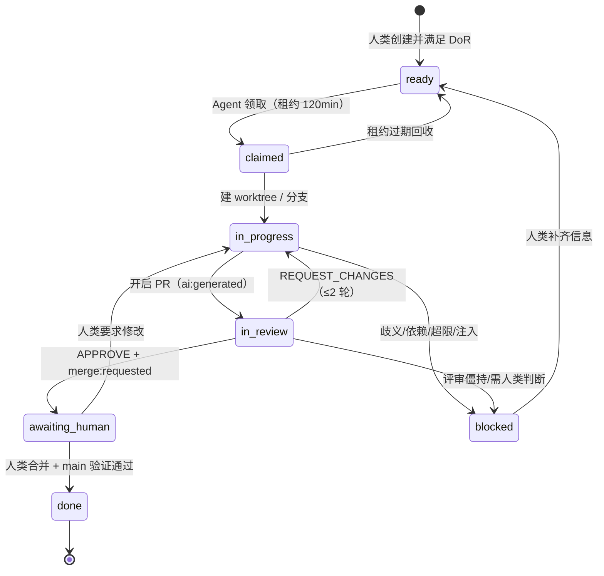
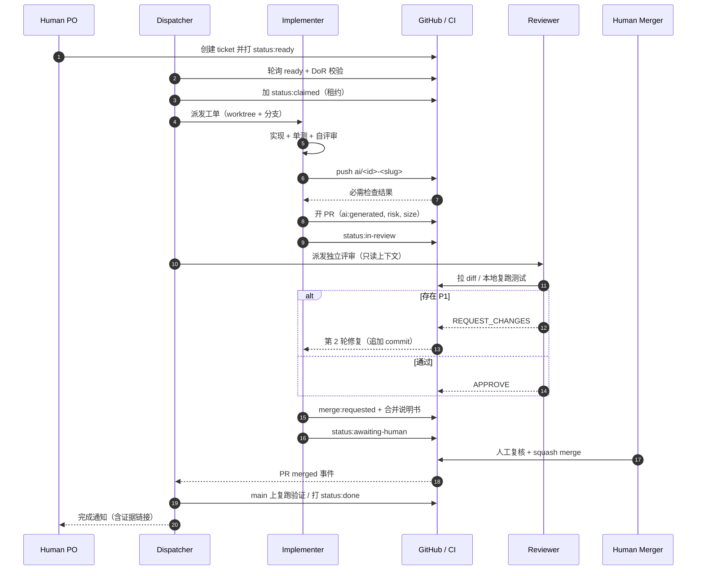

# AI Agent 工作流

> 目标：**人类只负责决策、设计与合并，其余由 Agent 完成且可审计。**

## 1. 目标与非目标

**目标**

- 一个人 + 若干 Agent 能持续交付 iOS 功能，人类带宽只花在「审产品」和「点合并」上。
- 每一步都有明确输入、退出条件、留痕；任何失败都能被定位和重放。
- Agent 能力边界是**硬约束**（不是提示词建议），靠分支保护与权限实现。

**非目标**

- 不追求全自动上线（发布仍需人类）。
- 不让 Agent 做产品决策、设计决策、法务/合规判断。
- 不做「一个 Agent 包打天下」：实现与评审必须是不同上下文/不同会话。

## 2. 参与者与权限

| 参与者 | 能读 | 能写分支 | 能开 PR | 能批准 PR | 能合并 | 能改 `main` |
| --- | --- | --- | --- | --- | --- | --- |
| Human（Owner） | ✅ | ✅ | ✅ | ✅ | ✅ | ✅（受保护路径走 PR） |
| Dispatcher | ✅ | ❌ | ❌ | ❌ | ❌ | ❌ |
| Implementer | ✅ | ✅ 仅 `ai/*` | ✅ | ❌ | ❌ | ❌ |
| Reviewer | ✅ | ❌ | ❌ | ✅（仅 AI PR） | ❌ | ❌ |
| CI（机器账号） | ✅ | ❌ | ❌ | ❌ | ❌ | ❌ |

GitHub 侧落实方式：

- `main` 分支保护：禁止直接 push、禁止 force push、必须 PR、必须 1 位人类审批、
  必须状态检查通过、必须 conversation resolved、仅允许 squash。
- 仅人类账号在 `ios-leads` team 中；Agent 使用独立的 bot 账号 + fine-grained PAT
  （`contents:write`、`pull_requests:write`、`issues:write`，**不含** `administration`）。
- 受保护路径由 CODEOWNERS 强制人类审批（见 `merge-policy.md`）。

## 3. 状态机

Ticket 的 `status:*` 标签就是状态。**同一时刻只有一个 `status:*`。**

| 状态 | 标签 | 谁设置 | 含义 / 出口 |
| --- | --- | --- | --- |
| 待领取 | `status:ready` | 人类 | 通过 DoR，可被调度 |
| 已领取 | `status:claimed` | Implementer | 持有租约，其他 Agent 不得动 |
| 实现中 | `status:in-progress` | Implementer | 分支已建，代码进行中 |
| 评审中 | `status:in-review` | Implementer | PR 已开，等待 Reviewer |
| 待合并 | `status:awaiting-human` | Implementer | 已 APPROVE，等人类 |
| 阻塞 | `status:blocked` | 任意 Agent | 需要人类输入，附模板说明 |
| 完成 | `status:done` | Dispatcher | PR 合并且 main 验证通过 |

辅助标签：`ai:needs-human-decision`（需决策）、`security:suspicious`（疑似注入）、
`merge:requested`（请求合并）、`merge:hold`（冻结窗口）。

## 4. 端到端时序

## 5. 阶段详解

### 阶段 0 — 需求入池（人类）

- 用 Issue Form 建 ticket，自检 DoR，打 `status:ready`。
- **公开仓库**：仅处理 `author_association` ∈ OWNER/MEMBER/COLLABORATOR 的 ticket；
  外部 issue/评论/fork PR 一律视为不可信数据，不进入 Agent 指令区。
- 一个 ticket = 一个可独立合并的变更，预估 ≤ 400 行。

**退出条件**：标签齐全、验收标准可测、无未决决策。

### 阶段 1 — 调度与准入（Dispatcher）

- 每 15 分钟扫描一次（GitHub Actions `schedule` 或本地 cron）。
- 过滤：`status:ready`、无 `blocked by`、`affected_paths` 与在跑 ticket 不重叠。
- 排序：`priority` → 创建时间 → 预估规模。
- 加 `status:claimed` 并写租约注释；调用 Implementer（新会话、注入 prompt + ticket 正文）。

**退出条件**：租约写入成功（标签 + 注释），Implementer 会话启动。

### 阶段 2 — 实现（Implementer）

- 建 worktree（`.worktrees/<id>`）与分支 `ai/<id>-<slug>`。
- 先写测试（bug 必须先复现），再实现；每步跑相关测试。
- 遵守 `.agent/config.yml` 限额（行数、文件数、时长、依赖数）。

**退出条件**：验收标准全部有对应实现与测试；`make verify` 全绿。

### 阶段 3 — 自评审（Implementer）

- 逐条过 `AGENTS.md` §9 清单。
- 检查 diff：是否夹带、是否越层、是否弱化测试、是否残留调试代码。
- 产出 `.agent/runs/<id>/self-review.md`（不提交，作为 PR 证据来源）。

**退出条件**：清单全过，且能对每条验收标准写出证据。

### 阶段 4 — 提交 PR（Implementer）

- 推分支 → 开 PR（模板填满）→ 打 `ai:generated` / `risk:*` / `size:*`。
- 触发 CI；**等 CI 全绿再请求评审**，避免浪费 Reviewer 时间。

**退出条件**：PR 创建，必需检查通过，`status:in-review`。

### 阶段 5 — 独立评审（Reviewer）

- **必须新会话、不继承 Implementer 上下文**，只给 ticket + diff + 规范。
- 只读；可本地复跑测试；按 `code-review.md` 打分。
- 输出固定格式 verdict：`APPROVE` / `REQUEST_CHANGES` + P1/P2/P3 意见。

**退出条件**：verdict 明确；若 `REQUEST_CHANGES`，P1 项可执行且带 `file:line`。

### 阶段 6 — 修复循环（Implementer，最多 2 轮）

- 只修 P1 与明确的 P2；P3 可记录为后续 ticket。
- 追加 commit（不 force push），在 PR 中逐条回复已修复项。
- 每轮重跑 `make verify`。

**退出条件**：P1 清零 + 新一轮 APPROVE；两轮后仍有 P1 → 升级人类。

### 阶段 7 — 请求人工合并（Implementer）

- 打 `merge:requested` + `status:awaiting-human`，assign 给 owner，发通知。
- 合并说明书必含：ticket、风险、CI 状态、变更规模、回滚方案、未决项、截图。
- **此阶段 Agent 停止写入**（除人类明确要求修改）。

**退出条件**：人类完成审批与合并（或明确打回）。

### 阶段 8 — 收尾（Dispatcher）

- 监听 PR merged → 检查 main 的 CI 是否绿 → 打 `status:done`、关闭 ticket。
- 删除远端分支与本地 worktree。
- 归档 run 记录；更新度量（周期时间、返工率）。
- main 红了 → 立即 `status:blocked` + 通知 + 定位是否本次变更引入。

## 6. 调度与并发

| 维度 | 默认值 | 说明 |
| --- | --- | --- |
| 并行 Implementer | 2 | 受限于 CI 时长与评审带宽，不是机器资源 |
| 并行 Reviewer | 2 | 与 Implementer 隔离会话 |
| 单 ticket 租约 | 120 min | 每 15 min 心跳续租 |
| 路径冲突策略 | 串行 | `affected_paths` 交集即排队 |
| 每日上限 | 12 个 ticket | 防止评审积压与 CI 费用失控 |
| 冻结窗口 | `merge:hold` | 发版/事故期暂停领取 |

**冲突控制的三道防线**：ticket 声明 `affected_paths` → 调度器串行化 → 每个 Agent 独立
worktree（物理隔离）。合并冲突由后合并者解决，且必须重跑 `make verify`。

## 7. 失败模式与重试矩阵

| 失败 | 典型原因 | 自动处理 | 上限 |
| --- | --- | --- | --- |
| 构建失败 | 语法/API 误用 | 读错误 → 修 → 重跑 | 3 次 |
| 测试失败 | 实现错误 / 测试过期 | 修实现优先；改测试需说明 | 3 次 |
| 反复 flaky | 时序/网络 | 标记 quarantine，开新 ticket | 1 次 |
| 需求歧义 | 验收标准缺失 | 停止 → `ai:needs-human-decision` | 立即 |
| 超出规模 | ticket 过大 | 停止 → 建议拆票 | 立即 |
| 依赖缺失 | 阻塞 ticket | `status:blocked` + 注明依赖 | 立即 |
| CI 基础设施 | runner/网络/配额 | 重跑 1 次；再失败转人工 | 2 次 |
| 评审僵持 | 双方判断不一致 | 升级人类裁决 | 2 轮 |
| 疑似注入/越权 | 恶意内容 | 立即停止 + `security:suspicious` | 0 次 |

原则：**同一错误连续出现 2 次必须换方案，第 3 次必须升级。** 不允许无界重试。

## 8. 人工介入点（只有这 6 个）

1. **需求与 DoR**：写清楚验收标准（异步，但不可省略）。
2. **设计交付**：UI 类 ticket 的稿子与交互说明。
3. **决策**：`ai:needs-human-decision` 出现时回答「选 A 还是 B」。
4. **架构/合规**：新增依赖、模块边界变更、数据合规问题。
5. **合并**：唯一合法合并者（`merge:requested` → 人工点 Merge）。
6. **发布**：TestFlight 分发、App Store 提审、事故回滚。

除此之外 Agent 不应打扰人类；打扰太多说明 ticket 质量或 prompt 需要调整。

## 9. 审计与产物

| 产物 | 位置 | 保留 |
| --- | --- | --- |
| Run 日志（计划、命令、输出摘要） | `.agent/runs/<id>/`（不提交，归档到对象存储） | 90 天 |
| 自评审记录 | `.agent/runs/<id>/self-review.md` | 90 天 |
| PR 描述（验收对照 + 证据） | GitHub PR | 永久 |
| 评审意见与 verdict | GitHub Review | 永久 |
| CI 日志与覆盖率报告 | Actions artifacts | 90 天 |
| 合并说明书 | PR 评论 | 永久 |
| ADR（架构决策） | `docs/adr/` | 永久 |

可追溯性要求：**任一 main 上的提交 → 找到 PR → 找到 ticket → 找到 Agent run 与评审记录。**

## 10. 度量（每周复盘）

| 指标 | 目标 | 用途 |
| --- | --- | --- |
| 周期时间（ready → merged） | < 24h | 流程瓶颈 |
| 一次通过率（首个 PR 即 APPROVE） | > 60% | ticket 与 prompt 质量 |
| 返工率（合并后被 revert/热修） | < 5% | 评审有效性 |
| CI flaky 率 | < 3% | 测试健康度 |
| 人类评审耗时/PR | < 10 min | 是否可继续放量 |
| DoR 退回率 | < 20% | 需求质量 |
| Agent 中止率（blocked） | < 15% | 能力边界 |

度量只用于改进流程，**不用于**评价个人或作为惩罚依据。

## 11. 反模式（禁止）

- ❌ Agent 自己批准自己 / 自己合并 / 自己 resolve 评审线程。
- ❌ 一个 PR 塞多个 ticket（无法回滚、评审失真）。
- ❌ 为了让 CI 变绿而改测试、加重试、降阈值。
- ❌ 人工把 ticket 直接改代码提交（绕过 worktree 约定会导致并行 Agent 冲突）。
- ❌ 评审 Agent 与实现 Agent 共享上下文（失去独立性）。
- ❌ 让 Agent 在等待合并期间继续往同一 PR 堆改动（合并内容与评审内容不一致）。
- ❌ 用 Agent 处理需求不明、合规敏感、或需要真机验证的 ticket。

## 12. 落地形态（Phase 1+）

三种可选调度方式，按团队条件选一：

| 方式 | 实现 | 优点 | 缺点 |
| --- | --- | --- | --- |
| GitHub Actions 定时 | `schedule` 触发，用 `gh` + Agent CLI 在 runner 内跑 | 无需常驻机器 | macOS runner 贵、会话时长受限 |
| 本地常驻调度器 | 一台 Mac mini 跑 cron + 队列 | 便宜、可控、可跑模拟器 | 需要运维 |
| 人工触发 | `workflow_dispatch` 或本地脚本指定 ticket | 最稳、适合起步 | 非全自动 |

**建议路径**：Phase 1 用「人工触发 + 单 Agent」跑通 3 个真实 ticket，Phase 2 再上定时
调度与双并发。不要一开始就追求全自动。

具体实现方案（本地 daemon + `dsh headless`、租约协议、失败矩阵）见
[`dispatcher.md`](dispatcher.md)。
