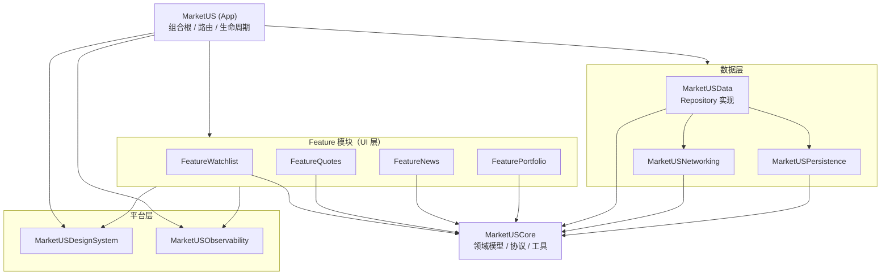
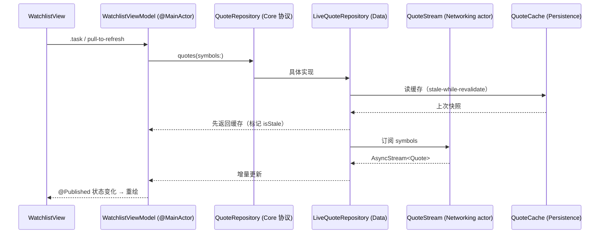

# 架构设计

> 状态：`Proposed`（Phase 0 规划）。决策记录见 [`adr/0001-ios-tech-stack.md`](adr/0001-ios-tech-stack.md)。
> 变更本文件描述的模块边界需要新增 ADR。

## 1. 目标与约束

| 目标 | 含义 |
| --- | --- |
| **可并行** | 多个 Agent 同时实现不同 ticket，写入集不重叠 |
| **可测试** | 业务逻辑不依赖 UI/网络/时间，单测覆盖核心路径 |
| **可增量** | 新功能以新增模块为主，少改老代码 |
| **可审计** | 每个变更能追溯到 ticket、Agent 运行、评审记录 |
| **低协作成本** | 团队小、Agent 多；避免需要大量口头同步的隐式约定 |

约束：

- 单人 + 多 Agent 的团队规模，**不引入重量级框架**（无 RIBs、无自研 DI 容器）。
- iOS 16.0+，Swift 6 语言模式，Xcode 最新稳定版（版本锁在 `.xcode-version`）。
- 不使用 iOS 17+ 专属 API（`@Observable`、SwiftData、`ContentUnavailableView` 等）。
- 行情数据为第三方授权数据，**不允许**在客户端长期留存或再分发（见安全文档）。
- 主工程由 **XcodeGen** 生成，`.xcodeproj` 不提交，规避二进制工程文件的合并冲突。

## 2. 分层总览



**核心约束：Feature 层只能看见 `MarketUSCore` 中的协议，感受不到网络与存储的存在。**
具体实现由 App 在组合根注入。

## 3. 模块清单

全部位于 `Packages/MarketUSKit/`，共用一个 `Package.swift`，以 **target** 做模块隔离
（比多 Package 更轻，仍能被编译器强制依赖边界）。

| Target | 职责 | 允许依赖 | 禁止 |
| --- | --- | --- | --- |
| `MarketUSCore` | 领域模型（`Quote`/`Symbol`/`Candle`/`NewsItem`/`Position`）、仓库协议、领域错误、`Clock`/`IDGenerator`、格式化工具、Feature Flag 协议 | Foundation | UIKit、SwiftUI、网络、存储 |
| `MarketUSNetworking` | `URLSession` HTTP 客户端、WebSocket 客户端、Endpoint 定义、重试/退避、ETag 缓存、限流、DTO | Core | SwiftUI、持久化 |
| `MarketUSPersistence` | 原子文件存储（`Codable`）、Keychain、磁盘缓存、Schema 版本与迁移 | Core | SwiftUI、URLSession |
| `MarketUSData` | Repository 实现、DTO↔Domain 映射、缓存策略、离线回退、错误翻译 | Core、Networking、Persistence | SwiftUI、UIKit |
| `MarketUSDesignSystem` | 语义色、字体、间距 Token、通用组件（`QuoteRow`/`ChangeBadge`/`Sparkline`）、无障碍封装 | SwiftUI | 业务模型 |
| `MarketUSObservability` | `Logger`（subsystem/category）、Analytics 事件、`OSSignpost`、崩溃标注 | Core、os | 业务逻辑 |
| `Feature<Name>` | SwiftUI 视图、`ObservableObject` ViewModel、导航契约、模块内组件 | Core、DesignSystem、Observability | 其他 Feature、Data、Networking、Persistence |
| `MarketUS`（App） | 组合根、DI、根路由、推送/深链、生命周期、Info.plist 配置 | 全部 | 业务实现细节 |

依赖规则由 `Package.swift` 的 `dependencies` 强制，**Reviewer 必须检查是否越层**。

## 4. 目录结构（模块级）

```
Packages/MarketUSKit/
├── Package.swift
├── Sources/
│   ├── MarketUSCore/
│   │   ├── Models/           Quote.swift, Symbol.swift, Candle.swift, NewsItem.swift
│   │   ├── Repositories/     QuoteRepository.swift（协议）, NewsRepository.swift
│   │   ├── Errors/           MarketError.swift, NetworkError.swift
│   │   ├── Support/          Clock.swift, IDGenerator.swift, Formatters.swift
│   │   └── FeatureFlags/     FeatureFlag.swift, FeatureFlagProvider.swift
│   ├── MarketUSNetworking/
│   │   ├── HTTP/             HTTPClient.swift, URLSessionHTTPClient.swift, HTTPRequest.swift
│   │   ├── WebSocket/        QuoteStream.swift, ReconnectPolicy.swift
│   │   ├── Endpoints/        MarketDataEndpoints.swift
│   │   ├── Policies/         RetryPolicy.swift, CachePolicy.swift, RateLimiter.swift
│   │   └── DTO/              QuoteDTO.swift, NewsDTO.swift
│   ├── MarketUSPersistence/
│   │   ├── FileStore/        AtomicFileStore.swift, WatchlistStore.swift
│   │   ├── Keychain/         KeychainStore.swift
│   │   └── Cache/            DiskCache.swift, CacheEntry.swift
│   ├── MarketUSData/
│   │   ├── Repositories/     LiveQuoteRepository.swift, LiveNewsRepository.swift
│   │   ├── Mappers/          QuoteMapper.swift
│   │   └── Composition/      DataContainer.swift
│   ├── MarketUSDesignSystem/
│   │   ├── Tokens/           Colors.swift, Typography.swift, Spacing.swift
│   │   └── Components/       QuoteRow.swift, ChangeBadge.swift, LoadingView.swift
│   ├── MarketUSObservability/
│   │   ├── Logging/          AppLogger.swift
│   │   ├── Analytics/        AnalyticsEvent.swift, AnalyticsClient.swift
│   │   └── Signposts/        Performance.swift
│   └── FeatureWatchlist/
│       ├── WatchlistView.swift
│       ├── WatchlistViewModel.swift
│       ├── Components/       WatchlistRow.swift
│       └── Routing/          WatchlistRoute.swift
└── Tests/
    ├── MarketUSCoreTests/
    ├── MarketUSNetworkingTests/     （URLProtocol stub）
    ├── MarketUSDataTests/           （fake repo + clock）
    └── FeatureWatchlistTests/
```

> 测试与被测 target 同名 + `Tests`，遵循 SwiftPM 约定，`swift test` 可直接跑核心逻辑
> （不依赖模拟器）；涉及 UI 的测试走 `xcodebuild test`。

## 5. 数据流

单向：**View → ViewModel → UseCase（可选）→ Repository 协议 → 实现（Data 层）→ 网络/存储**。



规则：

- View 不持有业务状态；ViewModel 是唯一可变状态源。
- 缓存优先渲染（< 100ms 出首屏），再补网络结果并标记 `isStale`。
- 所有 UI 状态变更在 `@MainActor`；后台 actor 只产出值，不触碰 UI。

## 6. 并发模型

- **Swift 6 语言模式 + `SWIFT_STRICT_CONCURRENCY: complete`**。
- `@MainActor`：ViewModel、App 路由、UI 相关类型。
- 状态容器用 `ObservableObject` + `@Published`（iOS 16 无 `@Observable`）；`@Published` 只在主线程写。
- `actor`：`QuoteStream`、`RateLimiter`、`DiskCache` 的写路径。
- `Sendable`：所有跨隔离边界传递的模型（值类型 + `let`）。
- 任务生命周期：View 用 `.task {}` 随视图消失自动取消；ViewModel 持有的长任务在
  `deinit`/`stop()` 中显式 `cancel()`。
- 禁止 `Task.detached`（除非有注释说明原因与取消策略）。
- 禁止 `DispatchQueue.main.async` 混用；统一用 `await MainActor.run` 或 `@MainActor` 标注。
- 竞态防护：同一资源的并发请求做**去重合并**（in-flight map），避免 UI 抖动。

## 7. 网络层

```swift
public protocol HTTPClient: Sendable {
    func send<T: Decodable & Sendable>(_ request: HTTPRequest) async throws -> T
}
```

- 超时：连接 10s / 整体 20s（行情接口单独 5s）。
- 重试：仅幂等 `GET`，最多 3 次，指数退避 + 抖动，遵守 `Retry-After`。
- 缓存：ETag / `If-None-Match`；按端点配置陈旧窗口（见下表）。
- 限流：按 host 的 token bucket，避免触发供应商配额。
- 错误映射：`URLError` → `MarketError.transport`；`401` → `.unauthorized`（触发登出流程）；
  `429` → `.rateLimited(retryAfter:)`；`5xx` → `.server`；解码失败 → `.decoding`（上报但不弹窗）。
- 请求/响应日志：仅记录 method、path、status、耗时；**不记录 body 与 header 中的凭证**。

### 7.1 数据源

默认使用 **Mock 行情**（App 内确定性生成，无网络、无密钥）；真实源（Alpaca IEX）仅作为
可选适配器，用于手工冒烟。Core 只定义 `QuoteFetching` / `QuoteStreaming` 协议，
厂商 DTO 不进入业务层。契约、场景与故障注入见 [`data-sources.md`](data-sources.md)。

| 数据 | 缓存策略 | 陈旧窗口 | 离线可用 |
| --- | --- | --- | --- |
| 自选股列表 | 本地持久化 | 立即 | ✅ |
| 实时报价 | 内存 + 磁盘快照 | 5s | 显示带「延迟」标记 |
| 历史 K 线 | 磁盘 | 1 天 | ✅ |
| 新闻 | 内存 + 磁盘 | 5 分钟 | ✅ |
| 账户/持仓 | 不缓存敏感字段 | 30s | 显示上次同步时间 |

## 8. 实时行情（WebSocket）

- 单连接，订阅上限 100 个 symbol；超出时按可见性 + 收藏优先级裁剪。
- 心跳 30s；断线重连指数退避（1s→30s，上限 5 次后降级为轮询）。
- 重连后**重新订阅**并拉一次全量快照，避免漏更新。
- 更新合并：250ms 窗口内同一 symbol 只保留最后一条，防止列表高频重绘。
- 不可用降级：WebSocket 不可用时切 HTTP 轮询（5s），UI 显示「延迟行情」角标。

## 9. 持久化

- **文件存储（`Codable` + 原子写）**：自选股、持仓快照、K 线缓存、设置；统一走
  `FileStore` 协议，便于替换与测试。
- **Keychain**：登录凭证（`kSecAttrAccessibleAfterFirstUnlockThisDeviceOnly`）。
- **UserDefaults**：仅 UI 偏好（主题、排序），不放敏感数据。
- **为什么不用 SwiftData**：最低 iOS 16，SwiftData 需 iOS 17。当前数据量小，文件存储足够；
  若出现关系查询/大数据量需求，再以 ADR 评估 Core Data（需提供迁移方案与测试）。
- 迁移：存储带 `schemaVersion`，只做**增量**变更；破坏性变更必须提供迁移测试与 ADR。
- 清除策略：登出时清空用户数据与缓存；磁盘缓存设上限（200MB）并按 LRU 淘汰。

## 10. 设计系统与导航

- Token 化：语义色（`gain`/`loss`/`neutral`/`surface`/`textPrimary`），**涨跌色可配置**
  （美式绿涨红跌 / 中式红涨绿跌），不硬编码 RGB。
- 组件先行：新 UI 先看 `MarketUSDesignSystem` 是否已有，避免各 Feature 重复造轮子。
- 导航：App 层持有 `NavigationStack(path: [Route])`，`Route` 定义在 Core/App，
  Feature 只暴露 `onSelectSymbol: (Symbol) -> Void` 之类闭包，**不互相 import**。
- 深链：`marketus://quote/AAPL` 与 Universal Link 统一映射到 `Route`。

## 11. 可观测性

| 类型 | 工具 | 规则 |
| --- | --- | --- |
| 日志 | `os.Logger`，subsystem `com.marketus.app`，category = 模块名 | 不含 PII、token、原始行情 payload |
| 性能 | `OSSignposter` | 启动、首屏、滚动卡顿 |
| 分析 | `AnalyticsClient` 协议 | 事件名 `feature.action`，属性白名单校验 |
| 崩溃 | 三方 SDK（Phase 3 决策） | 需隐私清单，禁止采集 IDFA |

性能预算（CI 或 nightly 监控）：

- 冷启动 → 首屏可交互 < 1.5s（P90，iPhone 12 及以上）
- 列表滚动 120fps 设备上掉帧率 < 1%
- 常驻内存 < 200MB
- 增量构建 < 90s，全量 < 5min（CI）

## 12. 可测试性设计

| 依赖 | 抽象 | 测试替身 |
| --- | --- | --- |
| 时间 | `Clock` 协议 | `TestClock` |
| 网络 | `HTTPClient` / `QuoteStream` 协议 | `URLProtocol` stub / `FakeStream` |
| 存储 | Repository 协议 | `InMemoryWatchlistStore` |
| 随机/ID | `IDGenerator` | 固定序列 |
| 定位/通知 | 协议封装 | 立即返回 stub |

原则：**ViewModel 必须能在无 UI、无网络、无真实时间的情况下完整测试。**

## 13. 错误处理

```swift
public enum MarketError: Error, Equatable, Sendable {
    case offline
    case transport(underlying: String)
    case unauthorized
    case rateLimited(retryAfter: TimeInterval?)
    case server(status: Int)
    case decoding
    case empty
    case cancelled
}
```

- 领域错误统一在 Data 层翻译，Feature 只做展示映射。
- 用户可见文案必须本地化，且给出**下一步动作**（重试 / 登录 / 稍后）。
- `.cancelled` 永不弹窗。

## 14. 演进策略

- 新功能 → 新 `Feature*` target，App 只加一行路由注册。
- 跨 Feature 复用 → 下沉到 `MarketUSCore`（模型/协议）或 `DesignSystem`（UI）。
- 需要新依赖 → ADR + 人类批准（见 `security-and-compliance.md` §依赖策略）。
- 模块拆分阈值：单 target > 8k 行或构建 > 60s 时，评估拆为独立 Package。
