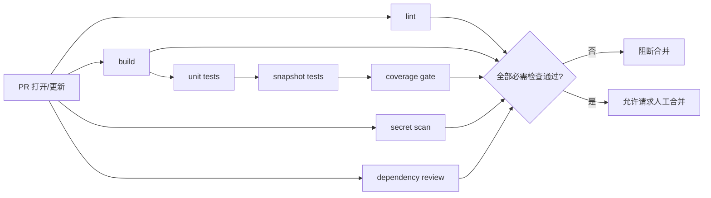

# CI / CD

> 目标：**每个 PR 都有可信、快速、不可绕过的机器验证**；合并与发布仍需人类。
> 流水线定义在 `.github/workflows/`（Phase 1 落地，本文件为规格）。

## 1. 流水线总览



## 2. 必需检查（分支保护）

| Job | 内容 | 阻断 | 预算 |
| --- | --- | --- | --- |
| `lint` | SwiftFormat `--lint` + SwiftLint `--strict` | ✅ | 2 min |
| `build` | `xcodegen` + Debug 构建（模拟器） | ✅ | 6 min |
| `unit-tests` | 单元 + 集成测试 | ✅ | 6 min |
| `snapshot-tests` | 组件/页面快照 | ✅ | 3 min |
| `coverage` | 本地 `make coverage`（需要 `make test` 产物）；CI 不跑 | ⚠️ 本地 | — |
| `secret-scan` | GitHub 原生 secret scanning + push protection（非 job） | ✅ | — |
| `dependency-review` | 新增依赖/许可证 | ✅ | 1 min |
| `ui-smoke` | 3–5 条关键路径（需本地/自托管模拟器） | ⚠️ 本地或 nightly | 8 min |
| `docs-lint` | 相对链接、markdown 格式 | ⚠️ 警告 | 30s |
| `ui-nightly` | 全量 UI + 性能基准 | 仅 nightly | 30 min |

PR 合并门槛 = 全部 ✅ 项通过 + 审批数达标（见 `merge-policy.md`）。

> **公开仓库**：标准 GitHub-hosted runner（含 macOS）免费且不计入额度，真正的成本是
> **排队时间**。因此 PR 只跑必需检查，全量 UI/性能放 nightly；fork PR 默认需人工批准才运行
> （见 [`infrastructure.md`](infrastructure.md)）。

## 3. Workflow 规格（示例）

```yaml
name: ci
on:
  pull_request:
    branches: [main]
  push:
    branches: [main]

concurrency:
  group: ci-${{ github.ref }}
  cancel-in-progress: true

permissions:
  contents: read
  pull-requests: read

jobs:
  lint:
    runs-on: macos-15
    steps:
      - uses: actions/checkout@v4
      - run: brew install swiftlint swiftformat
      - run: make lint

  test:
    runs-on: macos-15
    needs: lint
    steps:
      - uses: actions/checkout@v4
      # 生产环境把 Action 与镜像都 pin 到 SHA / 具体版本；此处版本须与 .xcode-version 一致
      - uses: maxim-lobanov/setup-xcode@v1
        with:
          xcode-version: "26.0"
      - uses: actions/cache@v4
        with:
          path: |
            .build
            ~/Library/Caches/org.swift.swiftpm
          key: spm-${{ hashFiles('Packages/**/Package.resolved') }}
      - run: brew install xcodegen
      - run: make bootstrap
      - run: make test
      - uses: actions/upload-artifact@v4
        if: always()
        with:
          name: test-results
          path: TestResults/
```

> 细节在 Phase 1 落地时确定：具体 Xcode 版本、runner 镜像、缓存键。**不要提交未经运行验证的
> workflow**——CI 自身的正确性也要有人负责。

## 4. 权限与安全

- Workflow 默认 `permissions: contents: read`，按需最小授权。
- 禁止在 `pull_request_target` 中检出并执行 PR 代码（防注入）。
- 所有密钥走 GitHub Secrets / Environments，**不进仓库、不进日志**。
- 签名证书与描述文件由人类维护（Phase 3 引入 fastlane match 时需 ADR）。
- 第三方 Action 必须 pin 到 SHA（而非 `@v4` 浮动 tag），新增 Action 需人类批准。

## 5. 速度策略

| 手段 | 收益 |
| --- | --- |
| SPM + DerivedData 缓存 | 省 2–4 min |
| `test-without-building` 分片 | 并行跑测试 |
| 只在 `Packages/` 变更时跑 `swift test` | 跳过模拟器启动 |
| PR 只跑冒烟 UI，nightly 跑全量 | 省 15+ min |
| `xcodegen` 缓存 / 预生成工程 | 省 1 min |
| 取消 superseded 运行（concurrency） | 省队列与费用 |

macOS runner 成本显著高于 Linux：**PR 上不跑全量 UI 测试**，这是硬性成本约束。

## 6. 分支保护配置清单（人类在 GitHub 设置）

- [ ] Require a pull request before merging（1 位人类审批）
- [ ] Dismiss stale approvals on new commits
- [ ] Require review from Code Owners
- [ ] Require status checks：`lint` `build` `unit-tests` `snapshot-tests` `coverage` `secret-scan`
- [ ] Require branches to be up to date
- [ ] Require conversation resolution
- [ ] Require linear history（squash only）
- [ ] Do not allow bypassing（包括 admins）
- [ ] Restrict force pushes / deletions
- [ ] Allow squash merge only；关闭 merge commit 与 rebase merge
- [ ] Auto-delete head branches

Agent 的 bot 账号**不得**拥有 admin 权限。

## 7. 发布（Phase 3+）

| 阶段 | 内容 | 人类参与 |
| --- | --- | --- |
| 版本号 | 从 Conventional Commits 生成 changelog | 确认 |
| 构建 | `xcodebuild archive` + 导出 | 触发 |
| 分发 | TestFlight（内部 → 外部） | 触发/审批 |
| 提审 | App Store Connect | 人类 |
| 灰度 | TestFlight 分组 / 服务端开关 | 人类 |

发布流水线**不自动触发生产**；任何 `workflow_dispatch` 都需要人类操作。

## 8. 失败排查

见 [`runbooks/ci-failure.md`](runbooks/ci-failure.md)。原则：

- 先判断是「代码问题」还是「基础设施问题」。
- 基础设施问题重跑 1 次；仍失败 → `status:blocked`，**不得**通过跳过检查来推进。
- flaky 测试按 `testing-strategy.md` §7 处理，禁止加重试掩盖。

## 9. Agent 在 CI 中的行为

- 可以读日志、定位、修复代码、重新 push。
- 不可以：改 workflow、改阈值、加 `|| true`、跳过 job、使用 `--admin` 合并。
- 同一失败连续 2 次 → 换方案；第 3 次 → 升级人类并附原始日志。


## merge-gate

PR 必须带 `merge:requested` 标签才能合并。`merge-gate` workflow 在
opened / reopened / synchronize / labeled / unlabeled 时检查。

启用强制门禁：在分支保护中把 `merge-gate / require-merge-requested` 设为 required check。
