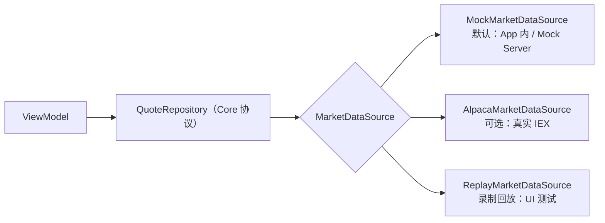

# 数据源方案（模拟行情 + 实时推送）

> 结论先行：**默认用自建 Mock（无 key、可离线、确定性）；真实数据只作为可选适配器。**
> 不把任何公共免费 API 当作 CI/开发的主依赖。

## 1. 为什么不用「公共免费 API」当默认

| 问题 | 影响 |
| --- | --- |
| 需要 API Key | 公开仓库不能提交密钥，每个贡献者/CI 都要配 |
| 限流与配额 | 单测、UI 测试、并行 Agent 会瞬间打爆配额 |
| 可用性无 SLA | 第三方抖动 → CI 红 → Agent 误判为实现错误 |
| 数据授权 | 真实行情不可入库、不可截图分发，公开仓库风险更高 |
| 语义漂移 | 字段/精度/时间格式变化会静默破坏测试 |

公开仓库的默认路径必须是：**零密钥、零外网、结果可复现**。

## 2. 候选对比

### 2.1 模拟 / 自建（推荐）

| 方案 | 稳定性 | 成本 | 实时 WS | 结论 |
| --- | --- | --- | --- | --- |
| **自建 Mock Server**（REST + WebSocket，Docker） | 完全可控，无外部依赖 | 一次性开发 ~1 天 | ✅ 自实现 | ✅ **采用** |
| **App 内 Mock Provider**（无网络） | 最高 | 极低 | ✅ 用 `AsyncStream` 模拟 | ✅ **采用（默认）** |
| 公共 demo 接口（如 Alpha Vantage `demo` key） | 低，随时限流/变更 | 免费 | ❌ | 仅手工冒烟，不入测试 |
| 抓取 Yahoo/网页行情 | 违反 ToS，随时失效 | 免费 | ❌ | ❌ 禁止 |

### 2.2 真实数据（可选适配器）

| 提供方 | 免费档关键限制 | WebSocket | 密钥 | 适用 |
| --- | --- | --- | --- | --- |
| **[Alpaca](https://docs.alpaca.markets/docs/about-market-data-api)** | Basic：IEX 实时、**30 个 symbol**、200 次/分、历史自 2016 但延迟 15 分钟 | ✅ `wss://stream.data.alpaca.markets/v2/iex` | 需要（Paper 账号） | ✅ **首选真实源** |
| **[Finnhub](https://finnhub.io/)** | 免费档含美股实时 WS，限流较紧（以官网为准） | ✅ | 需要 | ⚠️ 备选 |
| **[Twelve Data](https://twelvedata.com/)** | 免费档 credits/分钟 严格受限 | ⚠️ 受限 | 需要 | ⚠️ 备选 |
| **[Polygon.io](https://polygon.io/)** | 免费档以延迟/EOD 为主，实时 WS 属付费 | 💰 | 需要 | ❌ 现阶段不用 |
| **Alpha Vantage** | 免费档每日请求极少 | ❌ | 需要 | ❌ 仅冒烟 |
| **Stooq**（CSV） | 无 key、历史日线 | ❌ | 不需要 | ✅ **用于生成 fixture 种子数据** |

> 调研时间：2026-11。免费额度与字段随时变化，接入前必须以官网为准，并写成适配器隔离。

## 3. 推荐架构



- Core 只定义**领域协议**（`QuoteStreaming`、`QuoteFetching`、`NewsFetching`），不认识任何厂商。
- `MarketUSData` 提供多个实现，App 在组合根按配置选择：
  - `MARKET_PROVIDER=mock`（默认，Debug/CI/Demo）
  - `MARKET_PROVIDER=alpaca`（本地或手动触发的 live 冒烟）
  - UI 测试通过启动参数 `-marketScenario <name>` 强制 mock 场景。
- **任何测试都不得访问真实网络**。

## 4. Mock 设计

### 4.1 双层

| 层 | 位置 | 用途 | 需要网络 |
| --- | --- | --- | --- |
| App 内 Mock | `MarketUSData/Mock/`（`#if DEBUG`） | SwiftUI Preview、单元测试、UI 测试 | ❌ |
| Mock Server | `Tools/mock-market/`（Docker） | 手工 Demo、集成测试、演示录屏 | 本地 |

两者共用同一份 **JSON 契约**，避免「服务端能跑、测试不过」。

### 4.2 HTTP 契约

| 方法 | 路径 | 说明 |
| --- | --- | --- |
| `GET` | `/v1/symbols` | 标的列表（约 20 个美股，含 ETF） |
| `GET` | `/v1/quotes?symbols=AAPL,MSFT` | 最新报价（快照） |
| `GET` | `/v1/candles?symbol=AAPL&interval=1m&limit=390` | K 线（含盘前/盘后标记） |
| `GET` | `/v1/news?symbol=AAPL` | 模拟新闻（标题/来源/时间，内容为占位文本） |
| `GET` | `/healthz` | 健康检查（CI 等待就绪） |
| `POST` | `/v1/_scenario` | **仅测试**：切换场景/故障注入 |

```json
{
  "symbol": "AAPL",
  "price": "189.12",
  "change": "1.24",
  "changePercent": "0.66",
  "bid": "189.10",
  "ask": "189.14",
  "volume": 1283412,
  "ts": "2026-11-03T14:30:00.123Z",
  "session": "regular",
  "stale": false
}
```

**契约规则**

- 金额一律用 **字符串十进制**（`Decimal` 解析），禁止 `Double` 传输，避免精度与浮点漂移。
- 时间一律 **RFC 3339 UTC**（`Z`），服务端不做本地时区换算；客户端展示时再转 `America/New_York`。
- symbol 大写；`session` ∈ `pre | regular | post | closed`。
- 所有响应带 `x-request-id`，便于对日志。

### 4.3 WebSocket 契约

`ws://localhost:8080/v1/stream`

```json
{"type":"subscribe","symbols":["AAPL","MSFT"]}
{"type":"tick","symbol":"AAPL","price":"189.13","ts":"2026-11-03T14:30:01.456Z","session":"regular"}
{"type":"heartbeat","ts":"2026-11-03T14:30:30.000Z"}
{"type":"error","code":"unknown_symbol","message":"TSLA not in universe"}
```

- `subscribe` / `unsubscribe` 幂等；单连接 ≤ 100 symbols。
- 心跳 30s；服务端可主动断开以测试重连。
- 默认 4 次/秒/symbol，可配置（用于测节流与重绘）。

### 4.4 场景（可复现）

| 场景 | 行为 | 用于 |
| --- | --- | --- |
| `default` | 正态随机游走，种子固定 | 日常开发 |
| `bull` / `bear` | 带漂移的走势 | 截图/演示 |
| `volatile` | 高波动、频繁跳动 | 性能与节流测试 |
| `stale` | 只推心跳不推 tick | 「延迟行情」提示 |
| `disconnect` | 30s 后断开 | 重连与降级 |
| `slow` | 每请求 +2s 延迟 | 加载态 |
| `error500` / `rate429` | 固定错误 | 错误映射与重试 |
| `malformed` | 返回非法 JSON | 解码健壮性 |
| `empty` | 空列表 | 空态 UI |

场景由 `seed + scenario` 唯一确定 → 同一场景两次运行结果完全一致（快照测试的前提）。

### 4.5 技术选型

**Python + FastAPI + uvicorn**（单文件即可）：

- 天然支持 async/await 与 WebSocket，代码量最小（~250 行）。
- `pydantic` 直接复用为契约定义与响应校验。
- Docker 镜像小、启动秒级，CI 健康检查简单。

> 备选：Node + `ws`（若团队更熟 JS）。**不推荐** Swift/Vapor——为 mock 引入重型服务端依赖，且 iOS 开发者维护成本高。

## 5. 接入真实源的规则（Alpaca）

```bash
# 本地（不提交）
cp Config/Local.xcconfig.example Config/Local.xcconfig
# ALPACA_KEY=...
# ALPACA_SECRET=...
```

- 密钥只走 `Config/Local.xcconfig`（gitignored）或 GitHub Actions Secrets。
- 真实源只在**手动触发**的 job 中跑（`market-smoke.yml`），不进 PR 门禁。
- 30 symbol 上限 → 超过时按「可见 + 收藏」裁剪，Mock 侧也模拟该上限以提前暴露问题。
- 展示必须带来源与延迟标识（IEX 为单一交易所，非全市场 SIP）。

## 6. 与架构的衔接

| 组件 | 位置 |
| --- | --- |
| `QuoteFetching` / `QuoteStreaming` 协议 | `MarketUSCore` |
| `MockMarketDataSource` / `ReplayMarketDataSource` | `MarketUSData`（`#if DEBUG`） |
| `AlpacaMarketDataSource` | `MarketUSData`（独立文件，默认不编译进 Release 逻辑分支） |
| Mock Server | `Tools/mock-market/`（Docker） |
| 契约 fixture | `Packages/MarketUSKit/Tests/Fixtures/market/*.json` |

## 7. 验收清单（Phase 2）

- [ ] 无网络时 App 可用（mock 默认）
- [ ] `swift test` 不发起真实请求（可用断网验证）
- [ ] 同一 seed 两次运行输出一致
- [ ] 断线 → 重连 → 重新订阅 有测试覆盖
- [ ] 429/500/畸形 JSON 均有错误映射测试
- [ ] Mock Server 在 CI 中启动 < 5s，健康检查通过
- [ ] 真实源切换只需改配置，不改业务代码
