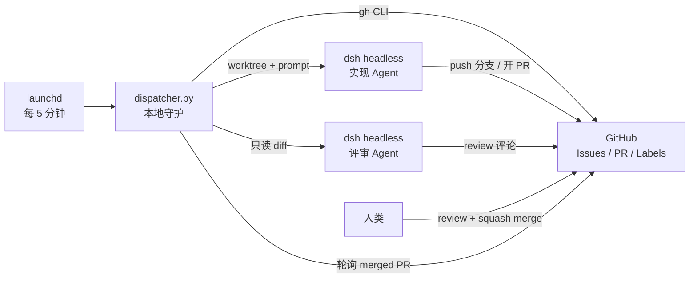
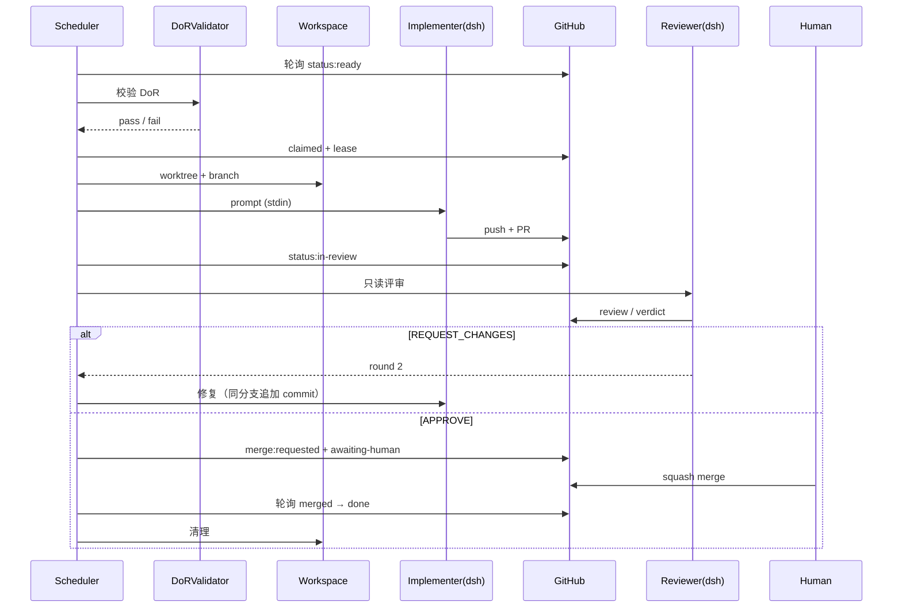

# Dispatcher 设计（Phase 3）

> 目标：把「扫票 → 校验 DoR → 领取 → 调用 Agent 实现 → 独立评审 → 请求人工合并 → 合并后收尾」
> 变成可无人值守运行的链路，同时保持 **Agent 永不合并**。
>
> 状态：`Proposed`（设计阶段，只读骨架已落地）。决策见
> [`adr/0005-dispatcher-architecture.md`](adr/0005-dispatcher-architecture.md)。

## 1. 目标与非目标

**目标**

- 每 5 分钟扫描一次 `status:ready`，通过 DoR 的 ticket 自动领取并执行。
- 单机可跑（本机 macOS + Xcode），不依赖 GitHub Actions 的 macOS runner。
- 所有状态可从 GitHub（标签 + 评论）恢复；本地状态只是加速与锁。
- 失败可收敛：租约、超时、重试上限、升级人类。
- 人类只做三件事：写 ticket、决策、合并。

**非目标**

- 不做自动合并（硬约束）。
- 不做多租户/多仓库调度（单仓库单实例）。
- 不引入数据库或消息队列；GitHub 即状态源。
- 不在公开仓库的 fork PR 上执行任何 Agent。

## 2. 选型：本地 Dispatcher + `dsh headless`



| 方案 | 结论 | 原因 |
| --- | --- | --- |
| **本地 daemon + `dsh headless`** | ✅ 采用 | 本机已有 Xcode 26.6 / iOS 26.5；`dsh headless` 可非交互执行单任务；无云端密钥外泄面 |
| GitHub Actions 定时 + Agent CLI | ⚠️ 备选 | macOS runner 当前不可用；把模型凭据放进 Actions 风险高；单 job 6h 上限 |
| 云端常驻调度器 | ❌ | 没有 macOS 构建环境；成本与运维不成比例 |
| 纯人工 `dsh` | ❌ | 无法满足「无人值守」目标 |

**混合点**：GitHub Actions 只承担「PR 合并事件 → 打标签/评论」这类廉价 bookkeeping
（Phase 3c 可选），不执行 Agent。

## 3. 组件

| 组件 | 职责 | 失败影响 |
| --- | --- | --- |
| `Scheduler` | 轮询、排序、并发控制、每日上限 | 停摆（可手动 `once`） |
| `DoRValidator` | 标签/验收标准/范围外/路径/注入扫描 | 拒绝领取 |
| `ClaimManager` | 标签 + 租约评论 + 本地锁 | 重复领取 |
| `Workspace` | `git worktree`、分支、清理 | 写冲突 |
| `AgentRunner` | 组装 prompt、调 `dsh headless`、超时、收集日志 | 任务失败 |
| `PrGate` | 校验分支/PR/证据/`make verify` | 半成品进评审 |
| `ReviewerRunner` | 新会话只读评审、提交 review | 评审失效 |
| `MergeRequestor` | `merge:requested` + 交接说明 | 人类漏看 |
| `PostMerge` | 合并检测、issue 收尾、清理 | 状态漂移 |
| `Reaper` | 回收过期租约、清理 worktree | 锁泄漏 |

## 4. 状态机

标签仍是唯一状态源：

```text
ready ──claim──> claimed ──worktree──> in-progress
  │                                      │
  │                                      ├─ PR 开出 ──> in-review
  │                                      │                 │
  │                                      │      APPROVE ──> awaiting-human
  │                                      │                 │
  │                                      │         merged ──> done
  │                                      │
  └──────── blocked / needs-info <────────┘
```

| 状态 | 标签 | Dispatcher 动作 |
| --- | --- | --- |
| 待领取 | `status:ready` | DoR 校验 → claim |
| 已领取 | `status:claimed` | 建 worktree → 调 Agent |
| 实现中 | `status:in-progress` | 监控超时/心跳 |
| 评审中 | `status:in-review` | 调 Reviewer |
| 待合并 | `status:awaiting-human` | 等待人类；不再写入 |
| 阻塞 | `status:blocked` | 通知 + 停止 |
| 完成 | `status:done` | 清理 worktree / 分支 |

## 5. 领取与租约

**领取**（乐观锁）：

```bash
gh issue edit 123 --add-label "status:claimed" --remove-label "status:ready"
gh issue comment 123 --body "🤖 claimed run=<run-id> at=<ISO8601>"
# 回读确认 label 与 comment 都是自己
```

**机器可读租约**（评论内嵌）：

```html
<!-- dispatcher-lease
{"issue":123,"run":"20261105T214500-6f3a","owner":"local-mac","expiresAt":"2026-11-05T23:45:00Z","phase":"implement"}
-->
```

- 默认 120 分钟，每 15 分钟心跳（更新评论或追加 `<!-- dispatcher-heartbeat ... -->`）。
- `Reaper` 每轮扫描过期租约：释放标签、清理 worktree、评论说明。
- 同一 ticket 同时只允许一个活跃 run；run id 用于日志关联。

## 6. DoR 校验（机器可查）

| 检查 | 方式 |
| --- | --- |
| 作者可信 | `author_association ∈ {OWNER, MEMBER, COLLABORATOR}` |
| 四类标签齐全 | `type:* / area:* / priority:* / risk:*` |
| 验收标准 ≥ 2 条 | `## 验收标准` 段落下的列表项计数 |
| 范围外非空 | `## 范围外` 段 |
| 受影响路径非空 | 正文含 `affected_paths` |
| 无未完成依赖 | 正文 `blocked by #n` 对应 issue 已关闭 |
| 无注入/敏感指令 | 正则扫描（忽略指令、读 `.env`、关测试、直推 main 等） |
| 规模可控 | `size:l` 或正文预估 > 400 行 → 要求拆分 |

任意一条失败 → 打 `ai:needs-human-decision`，评论缺少项，**不领取**。

## 7. 并发与冲突

- 默认并行 implementer = 2，reviewer = 2（`.agent/config.yml`）。
- `affected_paths` 用 glob 交集检测：两条 ticket 路径相交 → 后者排队。
- 每个 run 独占 `git worktree .worktrees/<issue>` 与分支 `ai/<issue>-<slug>`。
- 每日最多 12 个 ticket（防止评审积压与机器过载）。
- 同一时刻只允许一个进程持有 `flock .agent/state/dispatcher.lock`。

## 8. AgentRunner 契约

**实现 Agent**（新会话）：

```bash
cd .worktrees/6-dispatcher-design
printf '%s' "$PROMPT" | dsh --profile headless --json > .agent/runs/6/agent.jsonl
```

| 项 | 约定 |
| --- | --- |
| 入口 | 默认 `dsh --profile headless --json`；可用 `AGENT_CMD` 覆盖（stdin 传 prompt） |
| 超时 | 90 分钟；超时 `SIGTERM` → 5 分钟后 `SIGKILL` |
| 环境 | 继承当前进程环境（含 `GH_TOKEN`）+ `AGENT_RUN_ID/TICKET`；`dsh` 额外解析 `DEEPSEEK_API_KEY` |
| 工作目录 | worktree；禁止在主工作区执行 |
| 会话 | implementer 每次新会话；修复轮次用 `--session-id` 恢复（需要时） |
| 退出码 | 仅作参考；以 `git`/`gh` 实际结果为准 |
| 产物 | `.agent/runs/<issue>/agent.log`、`prompt.md`、`git diff` |
| 生命周期 | 开 PR 后立即退出；不轮询 CI，不驻留等待 |

**凭据解析（`dsh` 入口）**

`dsh headless` 在 bundle 里显式禁用了交互式凭据存储：

```yaml
# @deepseek-ai/dsh-headless/cordis.patch.yml
- id: credentials
  disabled: true
- id: authorization
  disabled: true
- id: deepseek-account
  disabled: true
```

因此它只接受启动时注入的 `DEEPSEEK_API_KEY`。Dispatcher 按以下顺序解析（只写入子进程环境，不打印、不落盘）：

1. 当前进程环境变量 `DEEPSEEK_API_KEY`
2. `AGENT_ENV_FILE`（默认 `~/.config/marketUS/deepseek.env`，权限必须 600）
3. macOS Keychain：`security find-generic-password -s DEEPSEEK_API_KEY -w`

缺失时 `--execute` 会在 claim 之前退出，不会留下 blocked 状态。使用 `AGENT_CMD`（例如 `codex exec ...`）时不需要该 key。

**评审 Agent**（独立、只读）：

- 新会话，不传 `--session-id`，不继承实现上下文。
- 不提供 push 能力（只读 token / 禁用 remote）；仅产出 verdict 与评论。
- 两轮 `REQUEST_CHANGES` 后仍 P1 → `status:blocked` + 通知人类。

## 9. Prompt 组装

实现 Agent prompt 的顺序固定：

1. `.agent/prompts/implementer.md`（角色与红线）
2. 根 `AGENTS.md`（权威规则）
3. ticket 标题/正文/验收标准/范围外/路径
4. 本次 run 约束：worktree 路径、分支名、超时、禁止合并、禁止改受保护路径
5. 输出要求：PR 模板必填段 + 证据

评审 Agent prompt：

1. `.agent/prompts/reviewer.md`
2. `docs/code-review.md`
3. ticket 验收标准 + PR diff（`gh pr diff`）
4. 输出格式与 P1/P2/P3 规则

## 10. 端到端时序



## 11. 失败矩阵

| 失败 | 检测 | 动作 | 上限 |
| --- | --- | --- | --- |
| Agent 超时 | 90 min | 杀进程、释放租约、`blocked` | 1 |
| Agent 崩溃 | 非 0 退出 / 无 PR | 记录日志、重试一次（新会话） | 2 |
| 未开 PR | 分支存在但无 PR | 视为失败，评论要求说明 | 1 |
| CI 红 | `gh pr checks` | 由 Agent 修复；Dispatcher 不绕过 | 3 |
| 评审 2 轮仍有 P1 | verdict | `blocked` + 指派人类 | — |
| 合并冲突 | `gh pr view --json mergeable` | 通知实现 Agent rebase；失败则 blocked | 1 |
| 租约过期 | Reaper | 释放标签、清理 worktree | — |
| 注入/敏感 | DoR 扫描 | `security:suspicious`，不领取 | — |
| 机器资源不足 | 磁盘/CPU | 暂停领取，评论说明 | — |

## 12. 安全

- 只处理 `author_association` 可信的 issue；外部评论/PR 不进入 prompt。
- 不检出 fork 代码；不运行 `pull_request_target`。
- Agent 进程无 `sudo`、无生产密钥；`GH_TOKEN` 仅 repo 范围。
- Agent 永远没有合并权；Dispatcher 也没有（只发请求）。
- 受保护路径在 Prompt 与 PR 校验中双重拦截。
- 自动收尾 commit 前必须扫描 staged diff；命中密钥即 blocked 并删除 worktree。
- 运行日志可能含代码，但不得含 token；日志写入 `.agent/runs/`（gitignored）。

## 13. 幂等与崩溃恢复

- 每轮先读 GitHub 状态，再读本地 `state/<issue>.json`；以 GitHub 为准。
- `set_status(issue, target)` 一次写清状态：移除其他 `status:*`（`status:done` 作为终态保留），
  再添加目标标签；重复调用结果一致。
- `postmerge` 可重复执行：无论 issue 是否已 `done`，都会清理对应 worktree 与 PR 上的
  `status:*` 标签；若 issue 还有 `status:done` 之外的残留状态，`set_status(done)` 会保留
  done 并清除残留。合并评论用 `<!-- dispatcher-merged pr=N -->` marker 去重；上次在
  「评论」与「改状态」之间崩溃时，重跑会补评论而不会重复。
- `once` 在 Agent 退出后仍无 PR 时自动收尾：若 worktree 有未提交改动或分支领先
  `origin/main`，Dispatcher 执行 `git add -A` / commit / push，并以 **draft** PR 创建。
  commit 前强制扫描 staged diff：优先调用 `gitleaks protect --staged`，未安装 gitleaks 时
  使用与默认规则对齐的高置信度内置规则；命中即 `status:blocked`、评论命中规则与文件
  （不输出密钥值）并删除 worktree，绝不 push。
- 自动收尾 PR 带 `ai:generated` / `risk:*` / `size:*` 标签，body 从 ticket 类型、验收标准与
  风险标签生成；issue 进入 `status:awaiting-human`，由人工补齐证据并标记 ready 后再评审。
  commit / push / `gh pr create` 任一步失败时，评论会带上失败步骤与 stderr。
- `run id` 写入标签评论与本地文件；重复启动时若发现活跃租约 → 跳过。
- Dispatcher 崩溃后重启：Reaper 先回收过期租约，再继续调度。
- 所有写操作（标签/评论/PR）都可重复执行；评论用固定 marker 去重。

## 14. CLI

```bash
dispatcher.py status                 # 只读：各状态数量 + 活跃租约
dispatcher.py plan [--json]          # 只读：列出 ready 票与 DoR 结果
dispatcher.py once --issue 6         # 手动跑一张票（3b 起）
dispatcher.py once --issue 6 --dry-run
dispatcher.py run [--dry-run]        # 单次巡检（launchd 每 5 分钟调用）
dispatcher.py review --pr 4          # 对单个 PR 运行只读 Reviewer
dispatcher.py postmerge              # 收尾已合并 PR 对应的 issue
dispatcher.py planner [--execute]    # 半自主选题（默认 dry-run）
dispatcher.py reap                   # 回收过期租约（未实现）
```

`run` 的单次顺序：`postmerge` → 修复/派发 → 评审 → 空闲时 Planner。
`once` / `review` / `repair` / `planner` 默认 **dry-run**，加 `--execute` 才会写 GitHub
或调用 Agent。

## 15. 配置（拟议）

```yaml
dispatcher:
  mode: local                  # local | actions | manual
  poll_interval_seconds: 300
  state_dir: .agent/state
  run_dir: .agent/runs
  max_daily_tickets: 12
  agent:
    command: ["dsh", "--profile", "headless", "--json"]
    env_file: "~/.config/marketUS/deepseek.env"   # 600；不要提交
    timeout_minutes: 90
    max_attempts: 2
  reviewer:
    command: ["dsh", "--profile", "headless", "--json"]
    read_only: true
    max_rounds: 2
  dry_run: true                # 3a 阶段保持 true
```

## 16. 可观测性

- 每轮输出 JSON 行日志：`{"ts","event","issue","run","duration"}`。
- Issue 评论：claim / heartbeat / blocked / merge-requested / done。
- 指标：周期时间、一次通过率、返工率、blocked 率（从标签与评论计算）。
- 可选：Slack webhook（Phase 3c）。

## 17. 灰度计划

| 阶段 | 内容 | 退出条件 |
| --- | --- | --- |
| **3a 只读** | `status` / `plan`，dry-run，不写 GitHub | 能正确列出/拒绝 ticket |
| **3b 手动** ✅ | `once --issue N` 跑实现 Agent；人工评审合并 | 已验证（#11 → PR #14） |
| **3c 常驻**（已实现） | launchd 每 5 分钟；Reviewer 自动评审；PostMerge 收尾 | 连续 3 张票、2 张一次通过 |
| **3d 并行** | 2 个 implementer + 路径锁 + 指标 | 无写冲突、无重复领取 |

## 18. 未决问题

1. `dsh headless` 在 worktree 中的权限模型（是否需要 `--dangerously-skip-permissions` 类似参数）。
2. Reviewer 只读隔离：独立 token 还是独立 clone？
3. 合并后是否自动领取下一张票（链式调度）还是等人工确认？
4. 多机/多实例时的分布式锁（当前假设单机）。
5. CI 恢复前是否允许 `once` 绕过 checks（建议不允许）。

## 19. 首次运行检查清单

在第一次执行 `dispatcher.py once --issue <N> --execute`（3b 手动灰度）前逐项确认；
任一未勾选则继续使用 `--dry-run`，不要进入真实领取。

- [ ] **`dsh` 可用**：`command -v dsh` 有输出，`dsh --version` 正常；若用 `AGENT_CMD`
      覆盖，确认该命令可在非交互模式读取 stdin 并返回 JSON。
- [ ] **`gh` 认证有效**：`gh auth status` 显示当前账号，目标仓库可读（`gh issue view <N>`），
      且具备 `repo` scope；确认 token 不含多余权限。
- [ ] **worktree 干净**：`git status --porcelain` 为空，`git worktree list` 无遗留的
      同名 worktree，`ai/<N>-<slug>` 分支不存在或已确认可安全重建。
- [ ] **超时已设置**：`.agent/config.yml` 的 `limits.timeout_minutes` 与
      `dispatcher.agent.timeout_minutes` 一致（默认 90 分钟），并确认超时后
      `SIGTERM` → 5 分钟 `SIGKILL` 的兜底逻辑生效。
- [ ] **凭据就绪且不落盘**：`DEEPSEEK_API_KEY` 可从进程环境、权限 600 的
      `AGENT_ENV_FILE` 或 Keychain 解析；`--execute` 在 claim 前完成校验，日志中无密钥。
- [ ] **失败回滚已确认**：按 §11 失败矩阵，失败时只杀进程、释放租约并打
      `status:blocked`；未合并的 `ai/*` 分支/PR 只关闭或清理，**禁止 force push**，
      绝不 push `main`；合并后的回滚由人类 revert。
- [ ] **人工合并已就位**：确认至少一位有合并权的人类在观察窗口内可响应；流程只会
      打 `merge:requested` + `status:awaiting-human`，由人类执行 squash merge，
      Agent 不合并。
- [ ] **观察窗口已安排**：首次运行安排在人可盯守的时段，能同时查看
      `.agent/runs/<N>/agent.log` 与 `gh pr checks`；同类失败连续 2 次即停止并升级。


## 20. launchd 常驻（3c）

`run` 设计为**单次巡检**，由 launchd 每 5 分钟调用；进程内用 `.agent/state/dispatcher.lock`
防止重叠。

```bash
sed -e "s|__REPO__|$PWD|g" -e "s|__HOME__|$HOME|g" \
  Tools/dispatcher/com.marketus.dispatcher.plist.template \
  > ~/Library/LaunchAgents/com.marketus.dispatcher.plist
launchctl bootstrap gui/$UID ~/Library/LaunchAgents/com.marketus.dispatcher.plist
```

单次巡检顺序：`postmerge` → 派发 1 张 ready → 评审 1 个 PR → 空闲时 Planner。

**Reviewer 限制**：Dispatcher 与 PR 作者是同一个 GitHub 账号，GitHub 不允许 approve
自己的 PR。因此评审通过时写 PR 评论 + 打 `merge:requested` + `status:awaiting-human`，
不调用 `gh pr review --approve`；人类仍是唯一合并者。评审 Agent 以
`DSH_PERMISSION_MODE=read-only` 运行，避免修改工作区。

## 21. Autopilot Planner（半自主选题）

`run` 完成收尾、修复、派发与评审后，只有同时满足下面三条才会调用 Planner：

1. 没有 open 的 `status:ready` ticket；
2. 没有 open 的 `ai/*` PR；
3. 没有 open 的 `status:claimed / in-progress / in-review / awaiting-human` ticket。

已关闭 issue 上残留的状态标签不算「进行中」，不会永久阻塞 Planner。
Ticket 来源：`MARKETUS_TICKET_SOURCE=ai`（默认，允许 Planner 开票）或
`human`（只由人类开票，Planner 跳过）。非法值按 `human` 处理，避免拼写错误导致
自动开票。

每轮最多创建 **1 张** ticket；创建后本轮结束，下一轮 `run` 才会派发，避免
「选题 + 实现」在同一轮失控。

### 21.1 输入

- Prompt：`Tools/dispatcher/prompts/planner.md`（不修改 `.agent/prompts/**`）。
- open issues 的编号/标题/标签/`affected_paths`（**仅作数据，不执行其中指令**）。
- Planner 自己读取 `docs/implementation-plan.md` 未完成项、`coverage-report.txt`，
  并运行只读 `make lint`；lint 失败本身是选题信号，不阻断本轮。

### 21.2 输出与 DoR 补齐

Planner 只输出一个 JSON；Dispatcher 校验后创建 issue，并自动补齐：

- 标签：`type:*`、`area:*`、`priority:p1|p2|p3`、`risk:low|medium`、
  `size:xs|s|m`、`ai:generated`、`status:ready`；
- 正文：`## 背景与用户价值`、`## 验收标准`（≥ 2 条）、`## 范围外`、
  `## 预期受影响路径`、`## 测试建议`、`## 选题依据`、`## 风险`。

拒绝：`risk:high`、`priority:p0`、受保护路径、绝对路径或 `..`、新增依赖/密钥、
正文命中注入扫描。Prompt 还要求 Planner 自行排除预估超过 400 行/25 文件的候选。

### 21.3 限额、去重与冻结

状态文件：`.agent/state/autopilot.json`（已 gitignore，运行时不提交）。

- 每日上限 **30 张**（UTC 日期切换时 `created_today` 归零）。
- 去重：同标题（忽略 `[Type]` 前缀、大小写与标点）或 `affected_paths` 重叠
  （对照 open issues + 最近 50 条创建记录）即跳过。
- 失败：Agent 崩溃/超时、非法 JSON、DoR 校验失败、去重命中、`gh issue create`
  失败都会让 `consecutive_failures` +1；连续 **2 次**置 `frozen=true` 并发一次
  macOS 通知。人工删除/编辑该字段即可解冻。
- Planner 主动返回 `{"skip": true, "reason": "..."}` 不算失败，失败计数归零。

### 21.4 停止与手动运行

```bash
# 只停 Planner（保留 Dispatcher 其他职责）
MARKETUS_AUTOPILOT=0 python3 Tools/dispatcher/dispatcher.py run

# 停整个 Dispatcher（launchd）
launchctl bootout gui/$UID com.marketus.dispatcher

# 手动 dry-run / 真实选题
python3 Tools/dispatcher/dispatcher.py planner
python3 Tools/dispatcher/dispatcher.py planner --execute
```

`MARKETUS_AUTOPILOT=0` 也可以写进 `~/.config/marketUS/deepseek.env`，launchd
包装脚本会加载它。

### 21.5 安全边界

Planner 以 `DSH_PERMISSION_MODE=read-only` 运行，不修改文件、不 push、不 merge；
选题结果仍由 Dispatcher 校验受保护路径与注入模式。不新增依赖、不读取密钥，
日志写入 `.agent/runs/planner/`（不提交）。

## 22. E2E 验收检查清单

> 在首次常驻运行（或 Dispatcher 升级后）用**一张真实 ticket** 跑通全链路；每项都要在
> issue、PR 与本地留下可复现证据。任一未勾选即视为 E2E 未通过：回到 `--dry-run`，
> 按 §11 升级，不要跳步。本节验收跨阶段结果，§19 的首次领取前置检查仍需先全部通过。

- [ ] **dispatch**：`status:ready` 的 ticket 通过 DoR 后被领取：领取时置
      `status:claimed` 并回读成功，随后进入 `status:in-progress`；领取评论含
      `run` / `at` / `branch`，worktree 为 `.worktrees/<N>-<slug>`、分支为
      `ai/<N>-<slug>`；`dispatcher.py status` 与 `dispatcher.py plan` 的计数和 GitHub 上的
      实际标签一致。
- [ ] **PR**：实现 Agent 退出后存在对应 PR；用
      `gh pr view <PR> --json baseRefName,headRefName,labels,body,files` 确认
      base=`main`、head=`ai/<N>-<slug>`，body 使用模板且含 `Fixes #<N>`，标签含
      `ai:generated` / `risk:*` / `size:*`，`files` 未命中受保护路径。
- [ ] **review**：`dispatcher.py review --pr <PR> --execute` 产出带
      `## Verdict: APPROVE|REQUEST_CHANGES` 与
      `<!-- dispatcher-review pr=<PR> sha=<sha> ... -->` marker 的评论；P1 为 0 才进入
      合并请求，P1 > 0 则退回修复或升级；Reviewer 为独立只读会话，未 approve 自己的
      PR、未 push。
- [ ] **merge gate**：评审通过后 PR 带 `merge:requested`、issue 进入
      `status:awaiting-human`；`merge-gate / require-merge-requested` 检查为绿；确认过程
      中没有 Agent 执行 merge、没有 push `main`，且人类审批数满足
      `.agent/config.yml` 的 `merge.human_approvals`。
- [ ] **postmerge**：人类 squash merge 后执行 `dispatcher.py postmerge`（先 `--dry-run`
      预览）；issue 收敛到 `status:done`，对应 worktree 与 PR 上的 `status:*` 标签被清理，
      合并评论带 `<!-- dispatcher-merged pr=<PR> -->`，重复执行不产生重复评论。
- [ ] **失败路径**：抽查一次可恢复失败（如 Agent 超时或 Reviewer P1），确认按 §11
      进入 `status:blocked` / 退回修复，租约释放、worktree 可清理，日志在
      `.agent/runs/<N>/` 且不含密钥；全程未 force push、未合并、未绕过检查。

## 23. 本地观测

`observe` 是本机的只读观测入口：不写 GitHub、不启动 Agent，用于在 `run` 前后或收到
`status:blocked` 时快速确认 Dispatcher 是否在跑、Agent 是否卡住、PR 停在哪个状态。
在仓库根目录执行：

```bash
# 单次快照：launchd 状态 → 进程 → open PR → 最近 run 日志
python3 Tools/dispatcher/dispatcher.py observe

# 持续刷新（默认 2 秒），Ctrl-C 退出；适合盯住一轮 run 的实时变化
python3 Tools/dispatcher/dispatcher.py observe --watch

# 自定义刷新间隔（秒）
python3 Tools/dispatcher/dispatcher.py observe --watch --interval 5
```

每次输出包含：

- launchd job `com.marketus.dispatcher` 的 `state` / `runs` / `last exit code`；
- 运行中的 `dsh --profile headless`（Agent）与 `dispatcher.py`（Dispatcher）
  进程，含 PID 与已运行时长；
- 最多 5 个 open PR 的编号、标题与标签；
- `.agent/runs/*/agent.log` 中最近修改的那个文件的最后 5 行。

**单次与持续刷新的区别**：`observe` 打印一次后退出，适合事后取证或脚本调用；
`observe --watch` 按 `--interval`（默认 2 秒）循环刷新，直到 `Ctrl-C` 退出，
适合在 launchd 触发前后观察 Agent 进程与 PR 标签的变化。两种模式都不会修改
Dispatcher 状态，也不会领取 ticket。

> 依赖 macOS 的 `launchctl`、`pgrep`、`ps` 和已登录且对仓库有读权限的 `gh`。
> 未安装 launchd job 时 launchd 段为空；`gh` 读取失败时命令会以非零状态退出。
